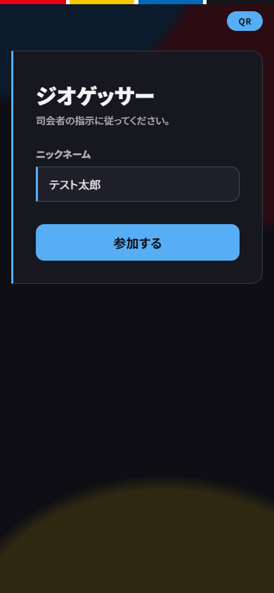
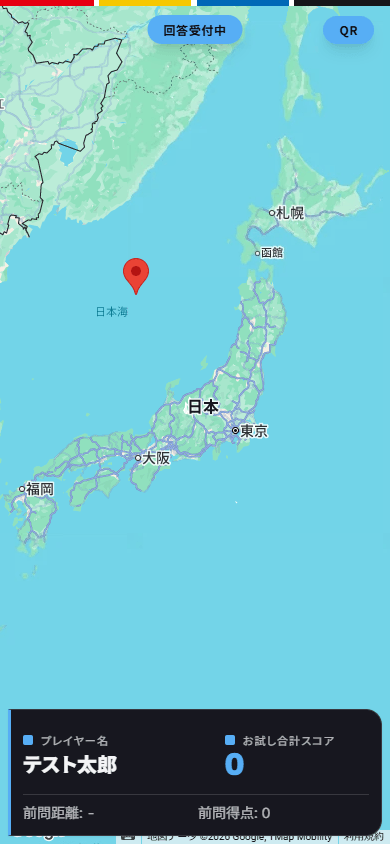
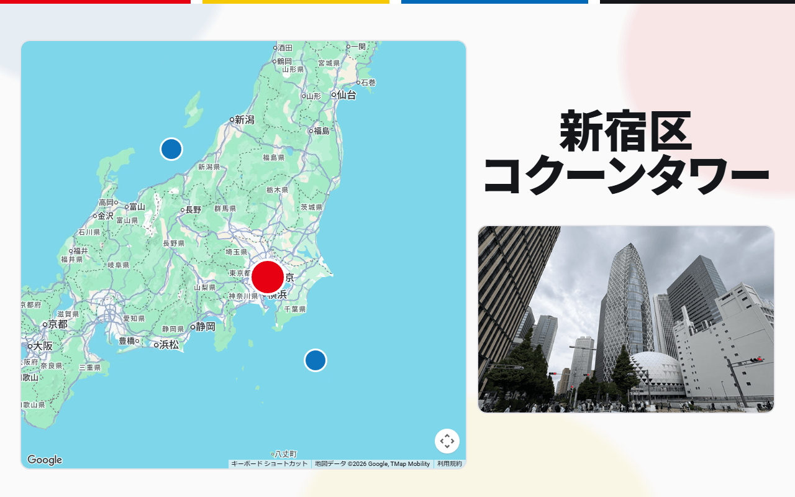
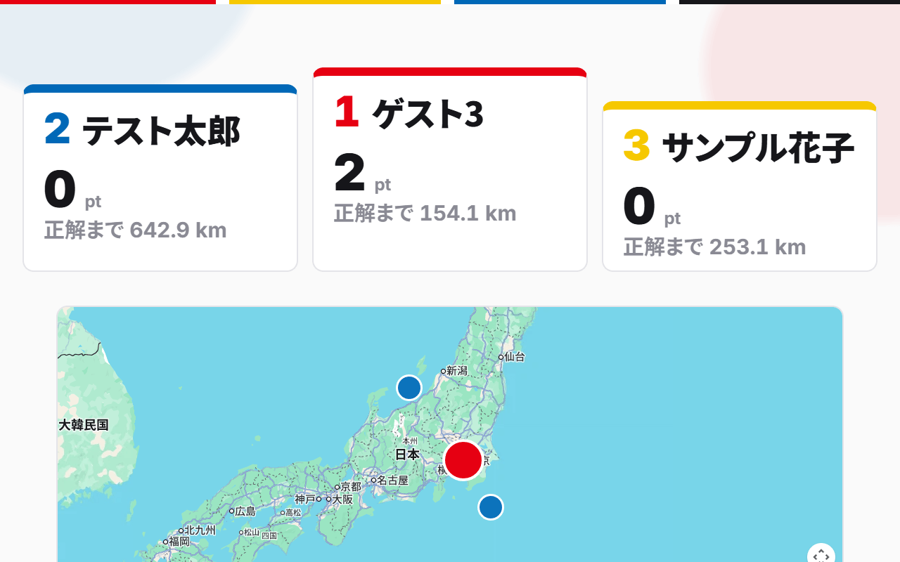
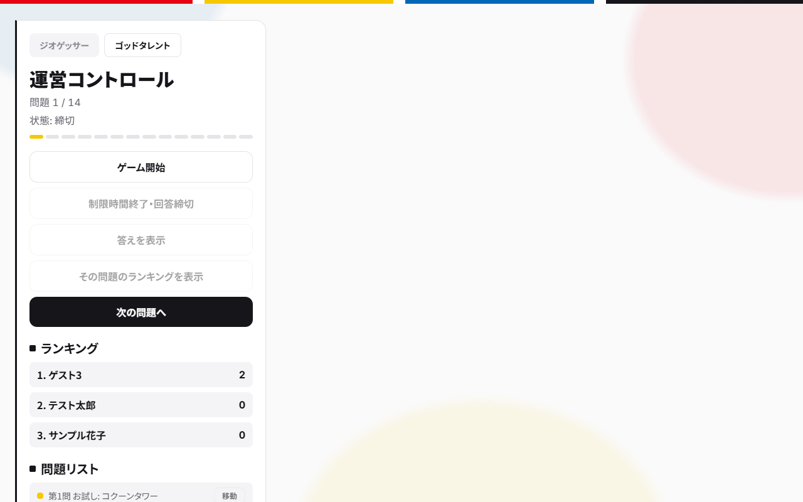
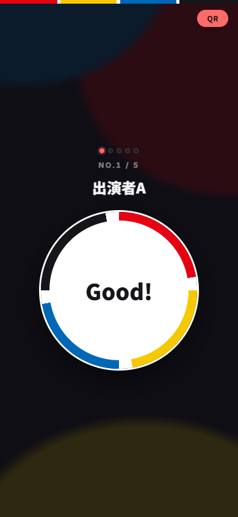
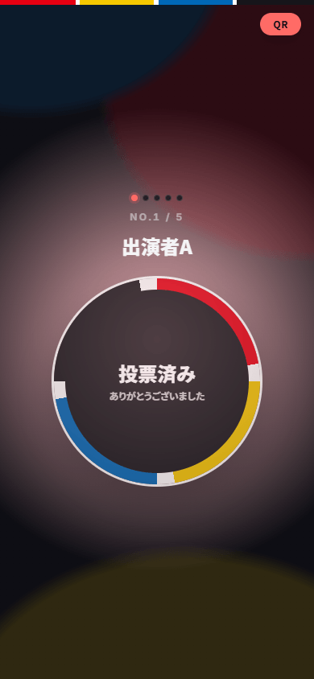
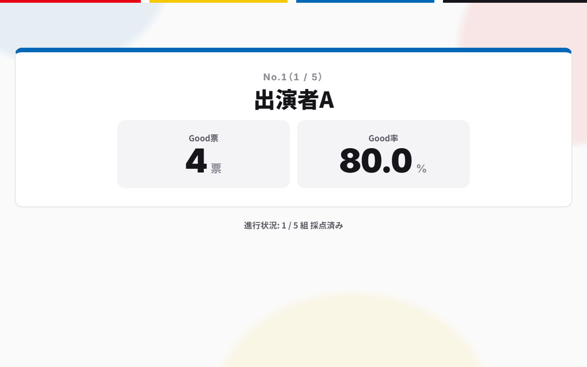
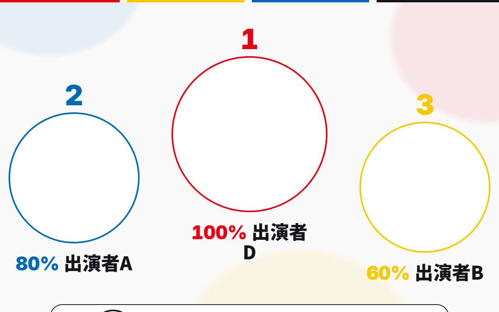
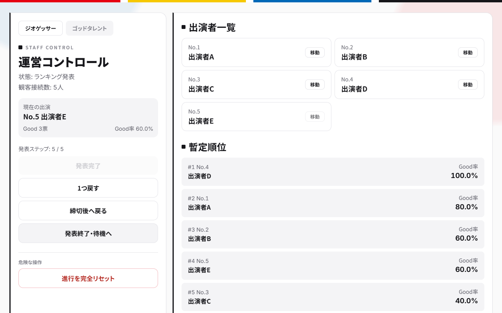

<div align="center">

# 🌍 魅儡祭 ステージ企画アプリ

**来場者のスマホ 130 台が同時に参加する、学祭ステージ用リアルタイム Web アプリ**


</div>

大阪国際工科専門職大学の学祭「魅儡祭」のステージ企画用に、個人で開発して当日の運用まで担当したアプリです。
会場スクリーンに映した QR コードを読み取るだけで、観客がスマホからステージ企画に参加できます。

開発者の私は実行委員長・ステージ進行・照明／スクリーン統括も兼任していました。
限られた時間で本番に間に合わせるため、実装には生成 AI を活用しています。
一方で、負荷の実測や本番での判断は自分で行いました。

## スクリーンショット

### 🗺️ GEO モード

**参加画面（スマホ）**：QR コードから開いてニックネームを入れて参加し、地図にピンを立てて回答します。

<table>
  <tr>
    <td></td>
    <td></td>
  </tr>
</table>

**投影画面**：答えを表示すると、正解地点と参加者のピンを地図に並べ、問題の写真を映します。



**投影画面（ランキング）**：その問題の順位と、正解までの距離を表示します。



**運営画面**：出題、締め切り、答えの表示、ランキングの表示を司会席から操作します。



### 👏 GOT TALENT モード

**投票画面（スマホ）**：出演中の組に「Good!」で投票します。投票すると「投票済み」に切り替わります。

<table>
  <tr>
    <td></td>
    <td></td>
  </tr>
</table>

**投影画面（締め切り後）**：その組の Good 票の数と Good 率を表示します。



**投影画面（ランキング発表）**：全組の採点が終わったら、Good 率の順に表彰台で発表します。



**運営画面**：投票の開始・締め切り、次の組への切り替え、ランキングの発表を操作します。



※ ローカルでサーバーとクライアントを起動し、架空のニックネーム・観客で撮影しました。GOT TALENT の出演者名は「出演者A〜E」に置き換え、顔写真は表示していません。

## 2 つのモード

### 🗺️ GEO モード

写真を見て撮影場所を当てる、GeoGuessr 風の対戦ゲームです。

- 参加者はスマホの地図（Google Maps）にピンを立てて回答します
- 正解地点との距離から得点を計算します（`S = 5000 × e^(−10·d/D)`：誤差 0 km で 5000 点、距離が離れるほど指数的に減点）
- 日本・世界などのカテゴリごとに集計し、スクリーンにランキングを表示します

### 👏 GOT TALENT モード

ステージのパフォーマンスに、客席のスマホから「Good」を投票する観客参加型の企画です。

- 有志 5 組（ミュージカル・歌・ビートボックス・剣道・けん玉）が対象です
- 投票数から Good 率を出し、結果をリアルタイムでスクリーンに表示します

### 画面構成

| 画面 | 使う人 | 役割 |
| --- | --- | --- |
| 参加画面 | 来場者（スマホ） | 回答・投票 |
| 運営画面 | 司会席 | 出題、締め切り、集計、画面切り替え |
| 投影画面 | 会場スクリーン | 問題、ランキング、Good 率の表示 |

## 本番の結果

| | |
| --- | --- |
| 同時接続数 | **130**（来場者のほぼ全員） |
| サーバー負荷 | Node プロセス **1 コアの約 50%** |
| 事前の負荷試験 | **150 接続**が全員ピンを動かし続ける最悪ケースを artillery で再現 |

## 工夫したところ

### 落ちたことから学んだブロードキャスト設計

本番前に運営メンバー約 60 人でテストしたところ、1 回目と 2 回目は全員の接続が切れました。
原因は、誰かがピンを動かすたびに全員へ全状態を配信していたことです。
送信量が参加人数の 2 乗（O(N²)）で増え、送信帯域が足りなくなっていました。

次の対策を入れ、3 回目のテストは問題なく通りました。

- **クライアント側**：ピンの送信を 300 ms デバウンスして、送信回数を減らす
- **サーバー側**：トークンバケット方式のレート制限（最大 20 通まとめて、毎秒 10 通ずつ回復）
- **集計**：全体で共通の集計はブロードキャスト 1 回につき 1 度だけ計算して使い回し、参加者ごとの値だけを差し込む

### 障害を前提にした運用

- 状態はすべてサーバーのメモリで持ち、DB は使っていません。企画の 2 時間だけ動けばよいので、構成をなるべく単純にしました
- 予期しない例外が出たらプロセスを終了し、systemd（`Restart=always`）ですぐに再起動します
- クライアントは自動で再接続し、`clientId` で同じ参加者として扱います
- 大量の WebSocket 接続に備えて、ファイルディスクリプタの上限と sysctl を調整しました
- WebSocket の Origin を検証して、別サイトからの不正な接続（CSWSH）を防いでいます

### 本番トラブルへの対応

当日、GOT TALENT モードで Good 率が全員 100% 近くに張り付く不具合が起きました。
Good 率の分母に「その時点の接続人数」を使っていたため、投票を終えて画面を閉じる人が増えるほど率が上がっていたのが原因です。

- **当日の対応**：全組の出演が終わってから再投票することを決め、司会・照明・音響と段取りを揃えました
- **後日の修正**：分母を「投票期間中の最大接続人数（high-water mark）」に変えました

## 技術スタック

| | |
| --- | --- |
| **Frontend** | React 18, Vite, Tailwind CSS 4, Google Maps（`@react-google-maps/api`） |
| **Backend** | Node.js, Express, ws（WebSocket）, winston |
| **Infra** | Vercel（フロント）, VM + systemd + nginx（サーバー） |
| **Test** | artillery（負荷試験） |

```
来場者のスマホ ×130 ─┐
運営画面（司会席）  ──┼─ WebSocket ─▶ nginx ─▶ Node.js（1 プロセス／状態はメモリ）
投影画面（スクリーン）─┘
```

## ディレクトリ構成

```
.
├── client/   # React アプリ（参加・運営・投影の各画面）
├── server/   # WebSocket サーバー（ゲーム進行、採点、集計）
└── deploy/   # systemd, nginx, sysctl の設定と artillery の負荷試験シナリオ
```

## 開発記録

開発から本番運用までの詳しい記録と、AI との役割分担は [ARTICLE_geogod_zenn.md](ARTICLE_geogod_zenn.md) にまとめています。

## Contact

- GitHub: [@Ryosei1009](https://github.com/Ryosei1009)
- Portfolio: [www.shinoryo.com](https://www.shinoryo.com)
- Mail: shinoryo1009@gmail.com
